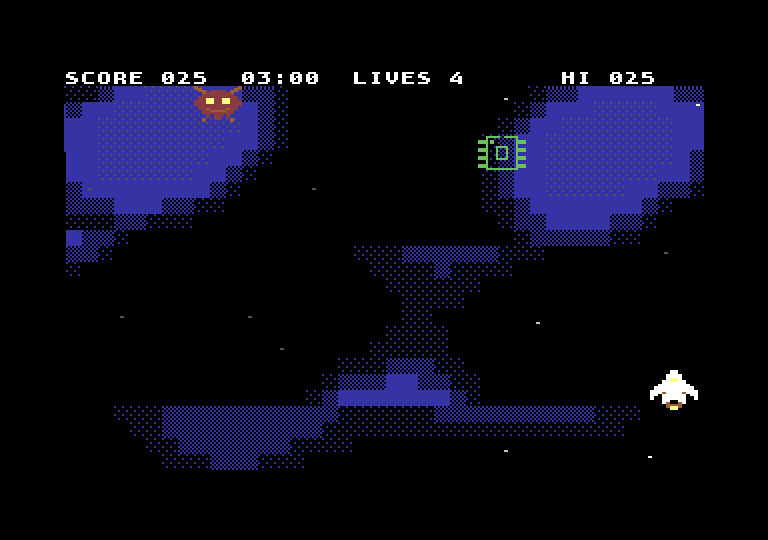
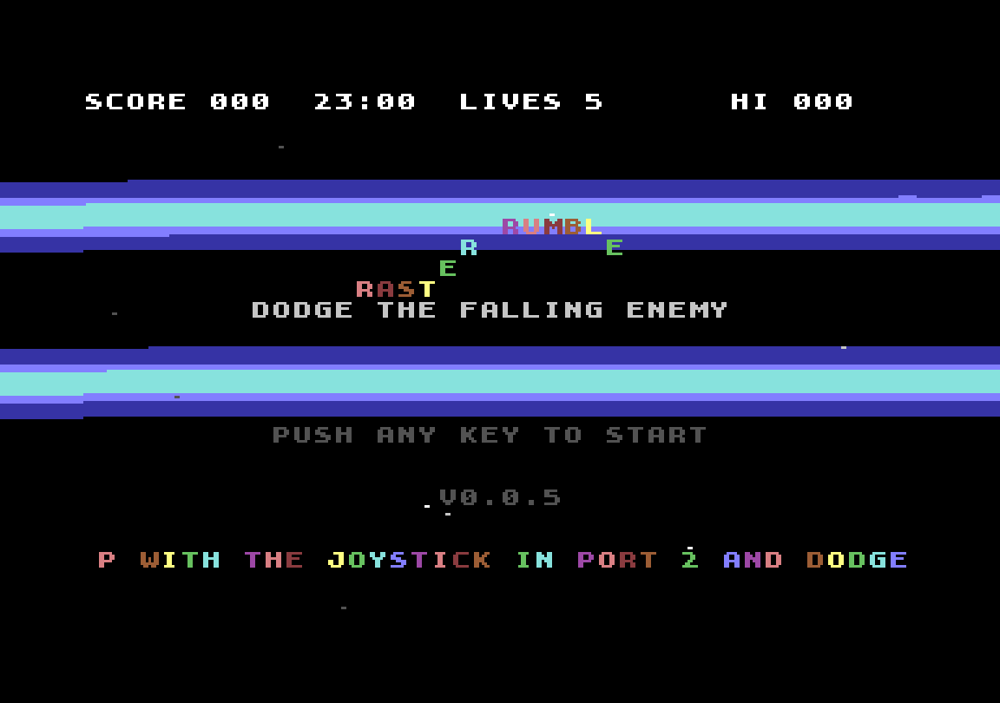
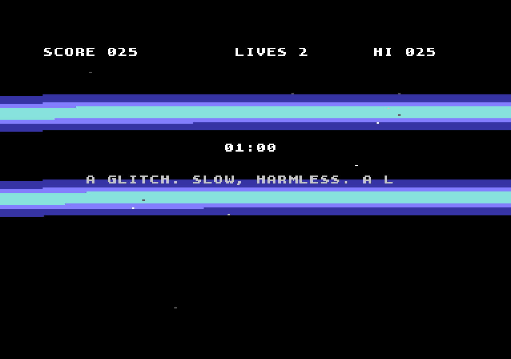
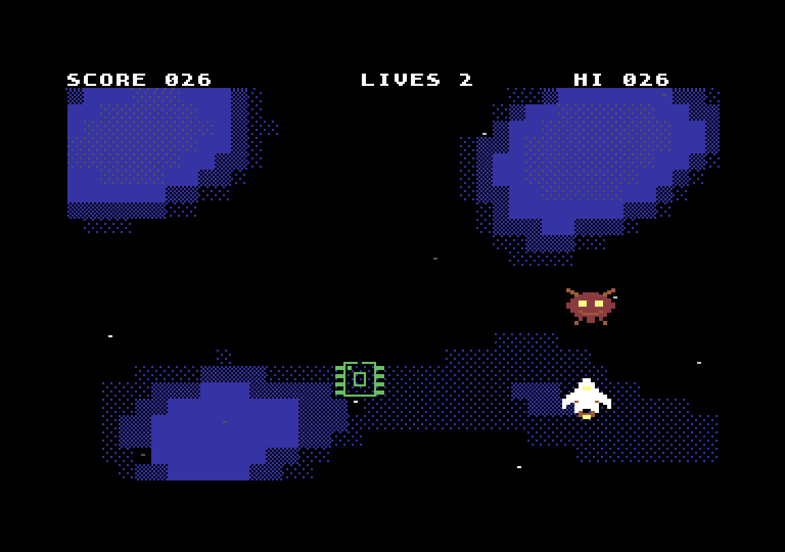
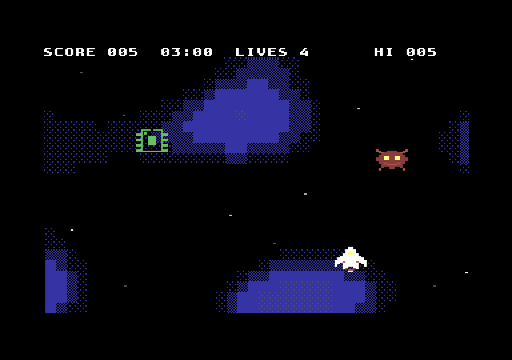
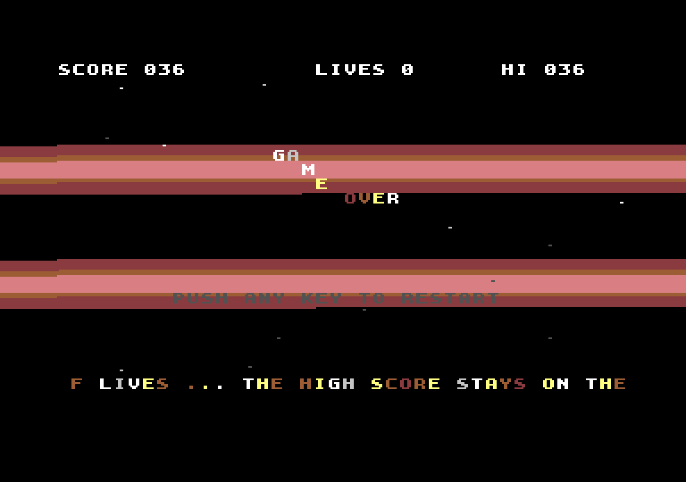

# raster-rumble

A Commodore 64 game written in 6502 assembly. Built for fun, nostalgia and, one day, real hardware.

**Status: alpha.** Download the latest build from the [Releases page](https://github.com/DDecoene/raster-rumble/releases/latest): the `.prg` for an emulator, Kung Fu Flash or Ultimate, or the `.d64` disk image. Two of the six chapters of the story are playable so far, and the third (The Border) is under construction.

**[▶ Play it now in your browser](https://vc64web.github.io/#openROMS=true#port2=true#https://raw.githubusercontent.com/DDecoene/raster-rumble/play/raster-rumble.prg)** (nothing to install: arrow keys steer, Space is fire, any key starts. The first start takes a few seconds)

| Title | Chapter screen |
|---|---|
|  |  |
| **The Glitch (the green chip, 01:00)** | **The Border (03:00): some enemies drift** |
|  |  |
| **Game over** | |
|  | |

A title screen waits for a key (or the joystick) before the game starts. You fly a ship along the bottom of the screen and dodge a falling enemy. Every dodge scores a point. The enemy gets faster as your score climbs and drifts toward you while it falls. You have 5 lives (`lives` at the top), and between the score and the lives the clock shows how far into the night you are (`23:00` to `07:00`). A hit flashes the border, plays an explosion and costs a life. After the last one a game over screen waits for any key, then a new game starts with score 000. The best score stays on screen as `hi`. Stars scroll behind the action and a dark, industrial techno loop plays while you dodge; the music and the sound effects are made in [WebSidTracker](https://github.com/DDecoene/WebSidTracker) and played by its player. After 25 dodges a chapter screen opens and the next hour of the night begins. In the second chapter (01:00) the Glitch, a second falling enemy that suddenly speeds up, joins in. From the third chapter (03:00, The Border) on, half of the enemies drift sideways while they fall and bounce off the left and right edges.

## Tools

    brew install acme

- **ACME** is the assembler (no Java needed).
- **vc64web** is the emulator. It runs in the browser and `make test` fetches it for you (see Testing in the browser).
- Editor: VS Code with the VS64 extension (`code --install-extension rosc.vs64`). It builds with ACME: press Ctrl-Shift-B. VS64 only supports ACME and Kick Assembler, which is why this project uses ACME.

## Build and run

    make        # assembles build/raster-rumble.prg
    make test   # builds, then runs it in the browser emulator (see below)
    make vice   # builds, then runs it in VICE (x64sc, the accurate emulator, with a 6581 SID: use it to judge the sound; brew install vice)
    make clean

Controls: joystick in port 2. In the browser emulator (`make test`) the arrow keys are the joystick (port 2), and Space is fire.

### Testing in the browser

The game runs in the vc64web browser emulator:

    make test      # builds, (re)starts a local server and opens the game in your browser
    make serve     # only the server, on http://127.0.0.1:8000 (Ctrl-C stops it)
    make stop      # stops the server that make test leaves running in the background

The first run clones the emulator into `tools/vc64web` (about 26 MB, ignored by git). `tools/serve.py` serves the emulator at `/` and the newest build at `/game/raster-rumble.prg`. It also changes the emulator a little as it serves it: it adds a small loader that fetches the newest build once the emulator runs (the emulator's own load-from-address feature did not work in every browser) and puts the keyboard on joystick port 2, and it replaces the offline cache that would keep serving an old build. So there is nothing to upload. After a change, run `make test` again, or `make` and reload the page. `make test` waits until the server answers before it opens the browser. The server keeps running in the background until you run `make stop`.

#### The dodging bot

`tools/bot.js` plays the game for you, to reach later chapters without playing by hand. Paste it into the browser console of the emulator page (or load it with a test tool), then use `bot.start()`, `bot.status()` and `bot.stop()`. It reads the sprite positions from the emulated C64 and steers with the arrow keys, walking to the spot on the screen that is farthest from the falling things (the enemy, and the Glitch once it is active). An enemy that drifts sideways counts twice: where it is now, and where it will be when it reaches the height of the ship (the bounces off the edges included). On the title and game over screens it taps Space, so it plays on after a game over. To test hits it can ram instead of dodge: `bot.start('enemy')` or `bot.start('glitch')` flies into that one (`'glitch'` dodges the enemy until the Glitch is in the game). In that mode it ignores the other falling thing, so that one hits too now and then. It only moves left and right and does not always survive: the status shows `best`, `maxChapter` and `games`.

### Joystick readout

To see what the C64 actually receives, set `SHOW_JOY = 1` in `src/config.asm`: the five digits on the top row are up, down, left, right and fire (0 = pressed).

To run on a real C64, copy `build/raster-rumble.prg` to an SD card for a Kung Fu Flash, Ultimate 64 or similar.

## The story

The game tells *The Night of the Raster Beam*. It is 1986 and a kid forgot to switch off the Commodore 64. Inside lives Pixel, a small ship. The Raster Beam that draws the screen has started to stutter, and at 07:00 someone will pull the plug. Pixel has until morning to write its name to the floppy disk, the only place that survives the power cut. Every hour of the night is a chapter, and a chapter screen with the time and one sentence shows between them.

| Time | Chapter | Playable |
|---|---|---|
| 23:00 | Boot | yes |
| 01:00 | The Glitch | yes |
| 03:00 | The Border | partly: enemies that drift sideways and bounce, the rest (flickering border, new colours and bass) is still to come |
| 04:30 | The Memory | not yet |
| 06:00 | The Raster Beam | not yet |
| 07:00 | The Disk | not yet |

The full story and the plans per chapter are in `docs/story.md`.

## Releases

The latest build is always on the [Releases page](https://github.com/DDecoene/raster-rumble/releases/latest): `raster-rumble-vX.Y.Z.prg` (emulators, Kung Fu Flash, Ultimate) and `raster-rumble-vX.Y.Z.d64` (disk image). We are in alpha, so versions are `0.0.x`.

How it works:

- The version lives in `src/version.asm` (`!scr "v0.0.5"`) and is shown on the title screen. `make version` prints it.
- `main` only changes through a pull request from `dev`. `.github/workflows/pr-check.yml` fails a pull request that comes from another branch, that does not raise the version above the one on `main`, or that does not build.
- When the pull request is merged, `.github/workflows/release.yml` builds the game, makes the disk image (with `c1541`, part of VICE), tags the commit `vX.Y.Z` and creates a release with both files and generated release notes.
- So the steps are: on `dev`, raise the version in `src/version.asm` in a commit, open a pull request `dev` to `main`, wait for the checks, merge.
- The same workflow puts the newest `.prg` on the `play` branch (one commit, replaced on every release). That is what the "Play it now" button loads: GitHub does not let other websites read release files (no CORS), but it does for `raw.githubusercontent.com`. The button opens the public emulator [vc64web](https://vc64web.github.io) with `#openROMS=true` (it installs the free open ROMs by itself), `#port2=true` (the keyboard is the joystick in port 2) and the address of the game. The emulator is vc64web (open source, based on VirtualC64); we only link to it. Until the first release made after this was added, the button has nothing to load.
- `make d64` and `make dist` (the release files in `build/dist`) do the same locally. They need `c1541`: `brew install vice`.

One-time GitHub setup (Settings, Branches, rule for `main`): require a pull request before merging, require the status check `check` (the job of `pr-check.yml`), and include administrators, so nobody can push to `main` directly.

## Project layout

    LICENSE               CC BY-NC-SA 4.0
    CONTRIBUTING.md       how to contribute, and who owns a contribution
    docs/screenshots/     the pictures in this README, and social-preview.png for the GitHub social preview
    src/main.asm          startup code and the main loop, includes everything else
    src/hardware.asm      names for the VIC, SID and CIA registers, colours, fixed memory areas
    src/config.asm        difficulty settings, screen layout, zero page and RAM variable addresses
    src/actors.asm        ship, enemy and Glitch: 9-bit X movement, spawning, homing, drifting and bouncing, difficulty
    src/score.asm         score and high score
    src/starfield.asm     RAM character set, scrolling stars, random_column
    src/sound.asm         the game's side of the sound: the player once per frame, the raster bars pump on the kick
    src/sound/            the WebSidTracker player and the exported instruments, effects and tune (MIT, see its README)
    music/raster-rumble.json  the music and the sound effects as a WebSidTracker project (open it in the tracker)
    src/title.asm         the title and game over screens and the any-key check
    src/demo.asm          their demo effects: raster bars, bouncing letters, scroller
    src/chapter.asm       the screen between two chapters of the story (see docs/story.md), and the clock on the top row
    src/data.asm          tables and text (star data, labels)
    src/version.asm       the version number (the one place it lives), shown on the title screen
    src/sprites.asm       the ship and enemy shapes at $2000
    tools/serve.py        local server for the browser emulator (make test)
    tools/bot.js          dodging bot for test runs in the browser emulator
    tools/version.sh      prints the version from src/version.asm (Makefile and workflows use it)
    .github/workflows/    pr-check.yml checks pull requests to main, release.yml builds and publishes a release
    project-config.json   VS64 project settings (toolkit: acme)
    .vscode/              build task, test task, launch config
    Makefile              command-line build

Every line of every file is commented (the files in `src/sound/` come from the tracker as they are). `main.asm` pulls the others in with `!source`, in the order they should sit in memory: code first, then data, then the sprites at `$2000`, then the sound at `$3000`. A build check stops when the code and data reach `$2000`; there are only a few dozen bytes left below it. `hardware.asm` and `config.asm` only contain names, so they use no memory. When you add a file, add a `!source` line for it in `main.asm` (paths are relative to the project folder) and check that the sprites still start at `$2000`. The Makefile rebuilds when any file in `src/` or `src/sound/` changes.

## How it works

- The program loads at `$0801` with a BASIC stub (`10 SYS 2064`), and the code starts at `$0810`. A build-time check fails if `start` moves off 2064.
- Sprite 0 is the ship, sprite 1 is the enemy. Both are multicolor (12 fat pixels per row, 2 bits each: transparent, own colour, plus orange and yellow shared by both sprites via `$d025`/`$d026`) and have two animation frames. Shapes: ship A `$2000` (pointer 128), enemy A `$2040` (129), ship B `$2080` (130), enemy B `$20c0` (131). The frame switches every 8 frames by bit 3 of `frame_count`. The shapes are drawn as ASCII art in the comments next to each row (`.` transparent, `a` orange, `b` own colour, `c` yellow).
- The main loop waits for raster line `$fb` (or later) once per frame, then picks the animation frame, scrolls the stars, reads the joystick, moves the enemy, checks the hardware sprite collision register (`$d01e`) and updates the score; that takes the beam to about line 26 of the next frame. Then `game_bars` sets the scroll bands and colours 4 plasma rows, and in the free lines after the plasma (from about line 200) it plays the music (`update_music`). When the music runs past line `$fb`, the next frame starts at once.
- Sprite X positions are 9 bits wide: the low 8 bits are in `$d000` (ship) and `$d002` (enemy), bit 8 is in `$d010` (bit 0 = ship, bit 1 = enemy). The visible area is X 24 to 343, so the ship moves between `MIN_X` = 24 and `MAX_X` = 320 (a 24 pixel wide sprite just fits). `ship_left`, `ship_right`, `enemy_left`, `enemy_right` and `home_enemy` do the 9-bit arithmetic: when the low byte wraps, they set or clear bit 8.
- Random numbers come from `random_byte` (in `src/starfield.asm`): an 8 bit shift register with feedback in zero page `$1e` (`rnd`), mixed with the raster line. (It used to read the SID voice 3 noise, but voice 3 plays the drums.) The enemy spawns at X = 24 + random column x 8 + 0 to 7 (`spawn_enemy`).
- The score is three separate digit bytes (hundreds, tens, ones) in zero page `$04`-`$06`, printed by adding `$30` to each digit.

### Title screen

`title_screen` (in `src/title.asm`) runs once at startup, before the first enemy appears. It hides the sprites, then loops once per frame: scroll the stars, play the music, redraw the three text lines (a star passing over a letter would otherwise leave a hole), and call `any_key`. The title letters cycle through 8 colours and "push any key to start" flashes. `any_key` first calls `cia_inputs` (both CIA ports back to inputs, timers off the port pins), then reports carry set when joystick port 2 has a pin low or any key in the keyboard matrix is down: it briefly drives all 8 keyboard columns low and reads the rows, then puts the CIA ports back as inputs for the game. For the first `RELEASE_FRAMES` frames all input is ignored (an emulator types its own RUN keys then), and a press only counts after one frame with nothing pressed; it then has to be down for `KEY_FRAMES` frames.

Note: in an emulator the title used to start by itself, and a joystick direction seemed to stick (raw bits `10101`). Three causes were found in the browser emulator. (1) CIA 1 timer B was set to show on port B pin 7, so keyboard row 7 (Space, Q, Run/Stop ...) read as a key down. (2) Data direction of port B (`$dc03`) read back as `$0f` instead of 0, which let the emulated keyboard pull joystick lines low. (3) The emulator types its own `run` a few seconds after loading the game. The game now calls `cia_inputs` before every joystick read, which sets both ports back to inputs and takes the timers off the port pins, and the title ignores all keys for `RELEASE_FRAMES` frames (5 seconds) after loading. After that, a key counts as soon as it is seen down for `KEY_FRAMES` frame (a quick tap in the browser emulator lasts about one frame).

### Memory map

| Address | Use |
|---------|-----|
| `$0400`-`$07e7` | screen memory (`$07f8`/`$07f9` hold the sprite pointers) |
| `$0801` | BASIC stub, `10 SYS 2064` |
| `$0810` | the code and the data tables (ends just below `$2000`, a build check guards it) |
| `$2000`-`$21bf` | the sprite shapes (blocks 128-134) |
| `$2800`-`$2fff` | RAM character set: ROM letters and digits plus the star shapes |
| `$3000`-`$3aff` | the sound: the WebSidTracker player (about 2 KB), its instruments, the effects and the tune |
| `$c000`-`$c003` | high score and its signature byte |

### Zero page

| Address | Name | Use |
|---------|------|-----|
| `$02` | `joy` | working copy of the joystick byte |
| `$03` | `hit_timer` | frames left of the red border flash |
| `$04`-`$06` | `score` | hundreds, tens, ones |
| `$07` | `enemy_speed` | pixels per frame the enemy falls |
| `$08` | `dodge_count` | dodges since the last speed-up |
| `$09` | `frame_count` | frame counter, slows the homing, drives the sprite animation |
| `$0a`, `$0b`, `$1d`, `$1f`, `$20` | | free (the old sound used them) |
| `$1e` | `rnd` | random number generator state (never 0) |
| `$21` | `dodge_flash` | frames left of the glow after a dodge |
| `$29`-`$2d`, `$2f` | `plasma_ph1`-`plasma_ph3`, `plasma_row`, `plasma_rowv`, `plasma_cnt` | the plasma: phases, next row, the vertical wave value, row counter for `plasma_init` |
| `$31` | `chapter` | which chapter we are in: 0 (23:00) to 5 (07:00) |
| `$32` | `chapter_dodges` | dodged enemies in this chapter so far |
| `$33` | `glitch_active` | 0 = no Glitch yet, 1 = it is falling |
| `$34` | `glitch_timer` | frames the current Glitch has been falling |
| `$35` | `enemy_dx` | sideways direction of the enemy: 0 = straight down, 1 = right, `$ff` = left |
| `$22`-`$24` | `band1`-`band3` | `$d016` value of each parallax band |
| `$25` | `exp_timer` | frames left of the explosion (0 = none) |
| `$26`-`$28` | `shake_x`, `shake_y`, `fx_tmp` | this frame's shake and a scratch byte |
| `$0c` | `key_count` | title screen: frames in a row with a key down (needs `KEY_FRAMES`) |
| `$0e` | `lives` | lives left, 0 = game over |
| `$0f` | `title_mode` | 0 = title screen, 1 = game over screen |
| `$0d` | `clean_count` | title screen: frames since it appeared, counts up to `RELEASE_FRAMES`, then `RELEASE_FRAMES` + 1 once a frame with no key was seen |
| `$e0`-`$ed` | `zp_music` | the WebSidTracker player (`src/sound/music.asm`) |
| `$fb`-`$fe` | `star_ptr`, `star_cptr` | pointers to a star's screen and colour RAM cell |
| `$fd`-`$fe` | `xlo`, `xhi` | scratch for building the enemy's 9-bit spawn X (shares the bytes of `star_cptr`, never used at the same time) |

### Starfield

12 stars scroll down behind everything, in three speeds (1, 2, 3 pixels per frame) and three greys, so the slow dark ones look far away. The ROM letters and digits (screen codes 0-63) are copied to RAM at `$2800` and `$d018` points the VIC at that copy. Screen codes 64-71 are 8 star shapes, each a dot in a different pixel row. A star moves down by switching to the next shape, and by one character row when it passes the bottom of its cell. Every star remembers what was in its cell before (`star_ucode`, `star_ucol`) and puts that back when it moves on. If a star flies into a cell where another star already sits, it must not remember that other star's shape as the background: when the two leave in the wrong order the shape would stay on the screen for good. On the title and game over screens there is no plasma to clean that up, and the dots piled up (11 star shapes on screen after 15 seconds, 47 after a minute, with only 12 stars). `update_stars` now remembers a plain space instead. Stars never touch row 0, which holds the score. Random columns come from `random_column`: a random byte mixed with the frame counter and reduced to 0-39 by subtracting 40 repeatedly. Re-reading the SID noise register a few cycles after a rejected value (the old source) gave strongly related values, which bunched all the stars into the left quarter of the screen. `setup_charset`, `setup_stars` and `update_stars` do the work.

### Sound

All sound comes from the player of [WebSidTracker](https://github.com/DDecoene/WebSidTracker), a SID tracker in the browser. The game writes nothing to the SID itself.

- **The project.** `music/raster-rumble.json` holds the tune and the sound effects. Open it in the tracker (Open), change it while it plays, Save it back, then Export and put `instruments.asm`, `sfx.asm` and `song_raster_rumble.asm` in `src/sound/`; `make vice` builds and runs the game with them. `src/sound/README.md` has the details and the licence (those files are MIT, the rest of the game CC BY-NC-SA).
- **The tune** is dark and industrial, made for the 6581 SID: 125 BPM (speed 1, 6 frames a sixteenth, 96 a bar), 12 bars that loop (about 23 seconds). Voice 1 a gritty pulse bass in sixteenths that jumps an octave (A, A, B flat, G); voice 2 a cold lead, a triangle ring-modulated by the bass (so its metal colour changes with every bass note), with a late vibrato, silent for the first 4 bars; voice 3 the kick (four on the floor), a metal hat and, after the intro, a snare.
- **The player** starts the tune once (`music_init` in `main.asm`) and runs once per frame through `update_music` (`src/sound.asm`): in the game at the end of `game_bars`, below the plasma; on the title, game over and chapter screens after the raster bars. After `music_play`, `update_music` looks at the player's state of voice 3 (`st_age`, `st_instr`): when a note of the kick (`SND_KICK`, instrument 2 of the project) starts, the raster bars are pushed on, so they pump with the beat.
- **Sound effects** borrow a voice; the music of that voice keeps time and comes back at its next note. A dodge plays `SFX_DODGE` on voice 3 (`score_point` in `score.asm`), a new chapter `SFX_CHAPTER` on voice 3 (`chapter_screen`), a hit `SFX_HIT` on voice 3 and `SFX_HIT_BODY` on voice 1 at the same time (the hit code in `main.asm`), so the lead on voice 2 always goes on.
- **Time.** `music_play` takes about 2000 to 6000 of the 19,656 cycles of a frame. To make room on the title screens, `update_stars` has a quick path for a star that stays in its cell, and the scroller colours, the tagline, the prompt and the clearing of the bouncing letters are written out instead of looped. Measured in VICE: the title work ends at most 148 of the 156 free lines after the bars; in the game the first scroll band was never more than one line late in 3244 frames.

### Joystick and the keyboard

Joystick port 2 is read from `$dc00`, the same CIA chip pins the keyboard matrix uses. When the joystick is mapped to keys in an emulator (arrow keys also count as C64 cursor keys), a held key combination can pull those pins low and show up as a phantom button: in VICE, arrow Up+Left read as fire as well. At startup the game sets both CIA 1 ports to inputs with their latches high (`$dc00`-`$dc03`), which stops that. `SHOW_JOY = 1` in `src/config.asm` prints the five raw bits (up, down, left, right, fire; 0 = pressed) on the top row for testing.

### Demo effects

The title and game over screens share the code in `src/demo.asm`, only the colours and texts differ (`pal_base`, `col_base`, `txt_ptr`, `scr_ptr`).

- **Raster bars.** `raster_show` waits for line `BAR_TOP`, then for every raster line up to `BAR_END` it writes one colour to the background and border (`$d021`, `$d020`). The colour comes from `barcol`, 256 bytes at `$c100` that `make_bars` fills once from the sine table and the bar palette. The sine step goes up by 4 per line, so a bar repeats every 64 lines, and `bar_phase` moves them. The writes sit right at the start of each line so the edges stay fairly straight. They are not cycle exact, so you may see small steps at the left edge. This works because the game does not use interrupts: the title polls the beam itself.
- **Scroller.** Row 22 is redrawn every frame from the text (stars cross it) (`scr_ptr`, ends with `$ff`). `raster_show` sets the fine scroll (`$d016` bits 0-2) on a raster line just above that row and back to 0 just below it, so only that row slides. `scr_fine` counts down by 2 pixels per frame, and every 8 pixels `scr_idx` moves one letter.
- **Bouncing letters.** `draw_bounce` puts each of the 13 letters on one of 4 rows (6 to 9), picked from the sine table, 16 steps apart per letter and moving 3 steps per frame. The game over text is padded to 13 letters, so both screens use the same code.

The frame sync is now `raster_show` itself. The rest of the frame (stars, music, text, key check) runs after the bars and must be done before line `BAR_TOP` (80) of the next frame; that is why those routines are written for speed.

### Game over

A hit does `dec lives`. When it reaches 0, `game_over` (in `src/title.asm`) runs the same wait-for-a-key loop as the title with `title_mode` = 1, so `draw_over` draws a red "game over" and a flashing "push any key to restart". It ignores keys for `OVER_WAIT` frames only (the player was just using the joystick). Then the score, lives, speed and ship position reset. The score and speed are not reset by a single hit, only by a new game. The high score is untouched.

### High score

The high score is three digit bytes at `$c000`-`$c002`, with a signature byte `$a5` at `$c003`. `$c000` is free RAM outside the program and the zero page, so nothing clears it: it survives hits, a restart with `RUN` and a reload of the program. Power-off wipes it. At startup `init_hiscore` checks the signature: if it is missing the high score is set to 000 and signed, otherwise the old value is kept. `update_hiscore` runs after every dodge and copies the score over when it is higher. It is drawn at the top right (`hi 000`).

### Tuning

These constants in `src/config.asm` change the difficulty without touching the logic:

- `ENEMY_SPEED`: starting fall speed in pixels per frame.
- `MAX_SPEED`: the fastest the enemy gets.
- `DODGES_PER_LEVEL`: dodges needed per speed-up.
- `CHAPTER_DODGES`: dodges needed to finish a chapter (use 2 while testing, 25 takes minutes).
- `ENEMY_DRIFT`: pixels per frame a drifting enemy moves sideways in The Border (higher is harder to dodge, and it reaches the edges more often).
- `GLITCH_WAIT`, `GLITCH_SLOW`, `GLITCH_FAST`: how long and how fast the Glitch falls.
- `LIVES`: lives per game. `OVER_WAIT`: frames the game over screen ignores keys.
- `HIT_FRAMES`: how long the border flashes after a hit.
- The tempo and the sound: change them in the tracker project (`music/raster-rumble.json`), see Sound.
- `STARS`: number of stars (the speed and colour tables repeat every 3).
- Homing rate: the `and #%00000001` before the homing code, in `src/main.asm`. Use `#%00000011` for slower homing.

## Notes on ACME

- `.local` labels belong to a `!zone`, not to the nearest normal label. Give each subroutine its own `!zone` if they share a local label name such as `.done`.
- `+` and `-` are anonymous labels: a branch to `+` goes to the next `+` below, a branch to `-` to the previous `-` above.
- `!scr "text"` converts to C64 screen codes. Lowercase in the source shows as capitals on screen in the default character set.
- `!source "src/file.asm"` pastes another file in at that spot, so a program can be split over several files and still assemble into one `.prg`. ACME looks for the path from the folder you run it in, and VS64 passes the project folder with `-I`.
- `!for k, 0, 7 { ... }` repeats a block at assembly time, which is how the 8 star shapes are written.
- VS64 passes `-DDEBUG=1` to ACME for its debug build, so never name your own symbol `DEBUG`: the build fails with "Symbol already defined". Test that build with `acme -DDEBUG=1 -f cbm --cpu 6510 -o /dev/null src/main.asm`.

## Ideas for later

- Save the high score to disk now that there is a title screen.
- More enemies at once (sprites 2-7 are free).
- A title tune.

### Game effects (src/effects.asm, game_bars in src/demo.asm)

- **Plasma behind the playfield.** A real 2D text mode plasma in dark blue, in the 24 rows under the score, drawn in extended colour mode (ECM, bit 6 of `$d011`): every cell has its own background colour, picked by bits 6 and 7 of its screen code from `$d021` (black) and `$d022` (the plasma colour, `VIC_BG1`). That is also why stars can sit on the plasma without a black box around them: a star gets the background bits of the cell it is in. ECM only has 64 characters, so the star shapes live at screen codes 33 to 40 (`STAR_CHAR`) and the two dither patterns at 41 (sparse) and 42 (checkerboard); the title screens do not use those codes. The value of a cell is the sum of three sine waves, as in the classic plasma: a horizontal one per column (`PLASMA_COLX`, once per frame in `plasma_prep`), a vertical one per row (`plasma_rowv`, once per row) and a diagonal one (`dtab`, period 32, read at x + row + phase). The sum (0 to 189) picks a screen code from `plasma_code` (black, sparse dots, checkerboard, or the plasma colour as background) and a colour for the dots from `plasma_ramp`; below 110 it is black, so only the peaks show. The inner loop of `plasma_step` patches its own addresses (self-modifying code) per row. `game_bars` colours 4 rows per frame between the scroll bands, and plays the music after them, so the whole plasma is renewed every 6 frames. A star remembers the code and colour that were in its cell (`star_ucode`, `star_ucol`) and puts them back when it moves on; `plasma_step` redraws the stars of its row. A star inside a dithered cell gets a plain cell (one background colour per cell). `plasma_init` colours all rows at once after the title and game over screens and switches ECM on; `reset_scroll` switches it off for those screens. Moods: nebula, fire during an explosion, a glow just after a dodge (`ramp_lo`/`ramp_hi`, `mood_bg1`). To make it dimmer, raise the 110, 125, 140, 160 thresholds in `plasma_code` and `plasma_ramp` (`data.asm`).
- **Explosion.** On a hit `start_explosion` launches 5 sprites (2 to 6, a round dot at `$2100`) from the ship in a star shape. `update_particles` moves them (9-bit X in `PART_LO`/`PART_HI` at `$c600`, switches a sprite off when it leaves the screen) and cycles white, yellow, orange, red. For `EXP_FRAMES` (28) frames the screen shakes: `update_bands` writes a random vertical scroll to `$d011` (below the playfield, where the VIC does not mind) and adds a random horizontal shake to the bands, with `shake_mask` making it smaller as the explosion ages. While `exp_timer` runs no new hit counts (the particles also set the sprite collision bits), a short grace period.
- **The Glitch (chapter 1 and later).** A second falling enemy on sprite 7: a green microchip in two hi-res frames (`glitch_data`/`glitch_data_b`, pointers 133/134, flickering every 8 frames). It appears when chapter 1 begins: `main.asm` calls `start_glitch` right after `chapter_screen` (the chapter screen switches all sprites off and back on, so it must come after). `start_glitch` sets `glitch_active` (`$33`), spawns it at a random X with `spawn_glitch` (which uses `pick_x`, shared with `spawn_enemy`) and sets bit 7 of `$d015`. `move_glitch` runs every frame: it falls slowly (`GLITCH_SLOW`) for `GLITCH_WAIT` frames (`glitch_timer`, `$34`), then fast (`GLITCH_FAST`), and gives +1 point when it reaches the bottom. A hit by the ship (`$d01e` `%10000001`) costs a life like the enemy does, and afterwards both respawn at the top. `reset_difficulty` clears `glitch_active`, so a new game starts without it. The explosion only uses sprites 2 to 6 so that sprite 7 stays the Glitch, and `update_particles` and `chapter_screen` keep bit 7 of `$d015` on while it is active.
- **The Border (chapter 2 and later).** From `chapter` 2 (03:00) `spawn_enemy` throws a four-sided die (`random_byte` and `#%00000011`): 0 or 1 means the enemy falls straight down, 2 drifts right, 3 drifts left. The direction lives in `enemy_dx` (`$35`): 0, 1 or `$ff` (-1; `bmi` tests the sign bit). Every frame the main loop moves a drifting enemy `ENEMY_DRIFT` pixels with `enemy_right` or `enemy_left` (the same 9-bit helpers homing uses), and a drifting enemy does not home: homing pulled it back to the ship, which is always on screen, so it almost never reached an edge. `bounce_enemy` (in `actors.asm`) turns it around at X 24 and X 320, the edges the ship uses too, comparing the 9-bit X with the high bit from `$d010`. A bounce can overshoot by one pixel because the check comes after the step. `spawn_enemy` and `reset_difficulty` set `enemy_dx` back to 0. Flying enemies still count as a dodge at the bottom (`MAX_Y`), so the chapter rules did not change.
- **The clock.** `draw_clock` (in `chapter.asm`) prints the five letters of `chapter_time` for the current chapter at `CLOCK_POS` on the top row, in white, between the score and the lives. It runs just before every chapter screen (which leaves row 0 alone, so the new time is already there while the chapter screen shows) and from `reset_difficulty`, so a new game starts at `23:00`. The title screen only clears rows 1 to 24, so the clock is visible there too.
- **Parallax bands.** The playfield is split in three bands (rows 1 to 6, 7 to 14, 15 to 24; the score row never moves). Each band has its own horizontal fine scroll (`$d016`, `band1` to `band3`, set at lines `BAND1_LINE` to `BAND3_LINE` by `game_bars`), 0 to 2, 0 to 4 and 0 to 7 pixels, from the ship X (`par_far`, `par_mid`, `par_near`): the stars lean the other way when you fly, the near ones most.

## Contributing and license

Contributions are welcome, see [CONTRIBUTING.md](CONTRIBUTING.md) (pull requests go to `dev`).

The game, its code, story and assets are licensed under [CC BY-NC-SA 4.0](LICENSE): you may play, share and adapt them with credit, for non-commercial use, and what you make from them must use the same license.

I have no intention of selling this game, but I do not want anyone else to sell it either. That is why the license is non-commercial, and why contributions are handed over to me: it keeps the whole project under one owner, free to play for everyone and protected from commercial use.
