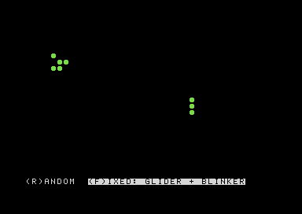

# sandbox

My own C64 experiments in 6502 assembly. Branched from raster-rumble, stripped down to the tooling.

## Conway's Game of Life

**[▶ Run it in your browser](https://vc64web.github.io/#openROMS=true#https://raw.githubusercontent.com/DDecoene/raster-rumble/sandbox/life.prg)** (nothing to install, the first start takes a few seconds)



A 40 x 24 world of balls on a torus: what leaves on one side comes back on the other. The bottom row is the status bar:

```
(R)ANDOM  (F)IXED: GLIDER + BLINKER
```

| Key | What it does |
|---|---|
| `R` | start again with a random world (about 3 in 8 cells alive) |
| `F` | start again with the next fixed pattern: glider + blinker, R-pentomino, acorn, glider gun |

The part of the bar that is running is shown in reverse. Every key press starts a new world.

The next generation is computed bit-sliced: 8 cells per byte at once, with AND/OR/EOR adders instead of a loop over single cells. A step takes about 24750 cycles and drawing the screen about 13050, together about 2 PAL frames.

`life.prg` in the root of this branch is the build, for an emulator or real hardware: `LOAD"LIFE.PRG",8,1` and `RUN`.

## Files

- `src/main.asm`: the program: start, main loop, keys, status bar, timing
- `src/life.asm`: the Game of Life itself: grid, patterns (add your own at the end), generation step, renderer
- `src/hardware.asm`: names for the chip registers (include it with `!source "src/hardware.asm"` when you need it)
- `make` builds `build/sandbox.prg`, `make test` runs it in the browser emulator. After a change, copy `build/sandbox.prg` to `life.prg` to update the online version.
